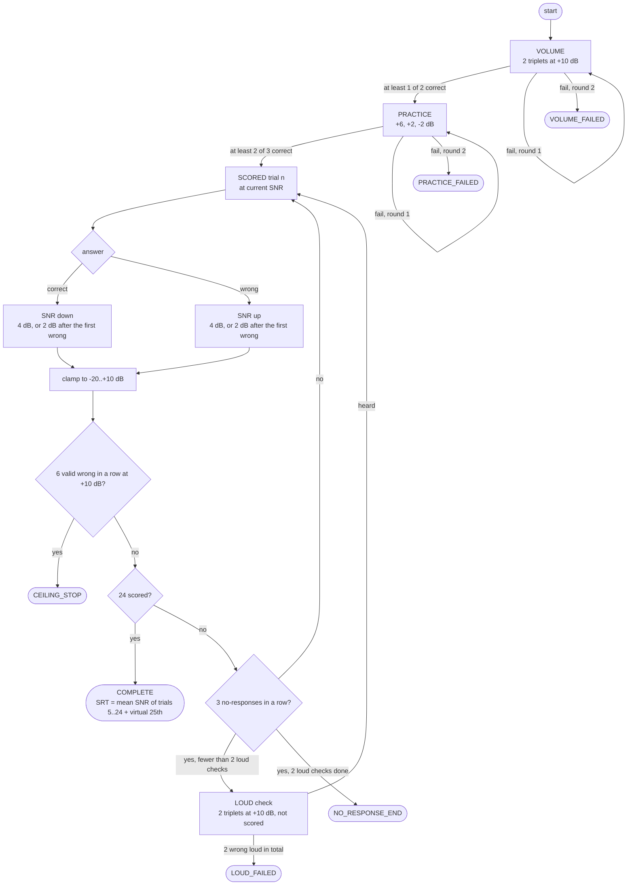
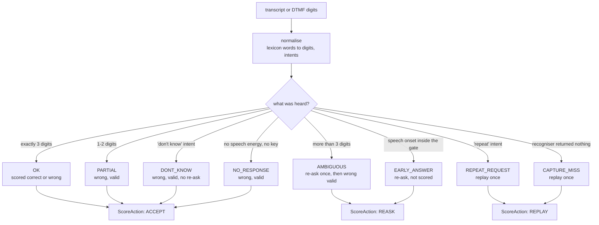
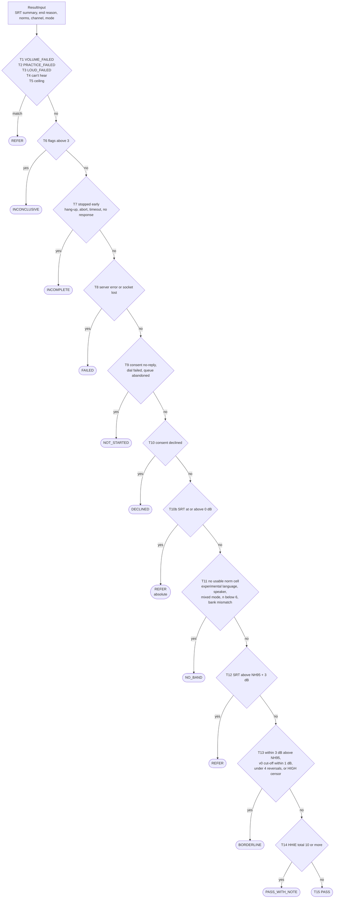
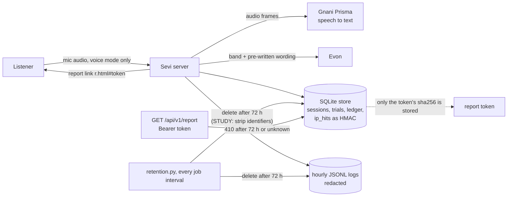

<div align="center">

# Sevi

### காது சோதனை · a digits-in-noise hearing screen over a phone-quality channel


</div>

> Sevi plays spoken digit triplets in background noise over a phone-quality channel, adapts the
> noise level to the listener's answers, and reports a speech reception threshold (SRT) with
> plain-language guidance. Answers can be spoken (streamed to Gnani Prisma v3) or typed on a
> keypad. **Sevi is a screening, not a diagnosis.** A result that needs follow-up points to a
> professional check.

---

## Why it matters

Hearing loss is common, gradual and easy to miss, and a hearing check usually needs a booth, an
audiometer and someone trained to run it. A digits-in-noise test needs none of those: it asks
the listener to repeat three digits heard in noise, and how much noise they can tolerate is
itself the measurement. Sevi runs that test in the listener's language (Tamil first) on the
devices people already have, and keeps every decision that matters in code, not in a model.

| | What | Source of truth |
|---|---|---|
| **Procedure** | 1-up/1-down staircase, 24 scored triplets, start 0 dB SNR, steps 4 dB then 2 dB, clamped to -20..+10 dB | `src/sevi/core/staircase.py`, `src/sevi/contracts/constants.py` |
| **SRT** | mean SNR of scored trials 5..24 plus the virtual 25th (21 values) | `Staircase.summarize` |
| **Result** | a first-match truth table, rules T1..T15 (+T10b), 10 bands | `src/sevi/core/result.py` |
| **Wording** | every user-facing string pre-written in Tamil and English | `src/sevi/copy/copy.yaml` |
| **Audio** | 16 kHz mix, band-pass 300-3400 Hz, 8 kHz μ-law on the wire | `src/sevi/core/dsp.py` |
| **Stimuli** | Timbre-rendered digit banks, RMS-equalised, frozen and hash-pinned | `stimuli/`, `src/sevi/calibration/freeze.py` |
| **Scoring** | lexicon normaliser over transcripts and keypad digits; ta 91 % / en 88 % exact on labelled forms | `src/sevi/core/scoring.py` |
| **LLM** | Evon may rephrase the code-selected wording; a guard rejects numbers, medical claims, reassurance | `src/sevi/app/explain.py`, `src/sevi/core/guard.py` |
| **Credits** | every Gnani call reserved against a hard per-key budget before any network I/O | `src/sevi/adapters/ledger.py` |
| **Privacy** | answers, sessions and logs deleted after 72 hours | `src/sevi/app/retention.py` |

## Table of contents

1. [What it is](#1--what-it-is)
2. [The measurement procedure](#2--the-measurement-procedure)
3. [Scoring an answer](#3--scoring-an-answer)
4. [From SRT to a band](#4--from-srt-to-a-band)
5. [Stimuli and calibration](#5--stimuli-and-calibration)
6. [Privacy and data](#6--privacy-and-data)
7. [Results](#7--results)
8. [Limitations](#8--limitations)
9. [Code map and how to run](#9--code-map-and-how-to-run)
10. [Who built what](#10--who-built-what)

---

## 1 · What it is

- **Tamil** is the banded language: the result maps to a band with pre-written wording.
- **English** is experimental: it reports no band.
- **Sevi is a screening, not a diagnosis.** A result that needs follow-up points
  to a professional check.

Two channels run the *same* test (one adaptive procedure, the same bank renders, the same scorer
and the same result classifier); only the transport differs:

| channel | answers | transport |
|---|---|---|
| **Browser** | voice (Prisma v3 streaming STT) or keypad | plain HTML/JS client, WebSocket `/web/stream`, AudioWorklet |
| **Phone** (Twilio trial, demo only, off by default) | keypad (DTMF); optional recording + Prisma REST | Twilio webhooks `/twilio/*`, `<Play>` + `<Gather>` |

### Audio chain

- **Phone-quality stimulus.** Stimuli are mixed at 16 kHz, band-passed 300-3400 Hz (Butterworth
  order 4) and sent on the wire as 8 kHz μ-law (`src/sevi/core/dsp.py`,
  `src/sevi/contracts/constants.py`).
- **Speech recognition.** Spoken answers stream to Prisma v3, which runs at 16 kHz; the stream
  session upsamples 8 kHz input 2x before sending (`src/sevi/adapters/prisma_stream.py`). A
  stream carries exactly one locale (live v3 rejects a list of locales).
- **Prompts.** Spoken instructions are pre-rendered with Timbre (`scripts/render_prompts.py`) and
  shipped under `stimuli/`.
- **Evon explainer.** After the test, Evon may add a short explanation of the band. Its reply passes
  a guard (`src/sevi/core/guard.py`) that rejects any number, medical claim or reassurance; on
  rejection, timeout, an open breaker or when disabled, Sevi falls back to the pre-written template
  (`src/sevi/app/explain.py`).

---

## 2 · The measurement procedure

The procedure is a pure function of its state (`src/sevi/core/staircase.py`): every answer
returns a new `ProcedureState`, and `_next_snr` is the only SNR rule. All numbers below are
constants in `src/sevi/contracts/constants.py`.

| phase | what happens | pass rule |
|---|---|---|
| **VOLUME** | 2 triplets at +10 dB SNR, up to 2 rounds (a "turn it up" prompt between) | >= 1 of 2 correct; else `VOLUME_FAILED` |
| **PRACTICE** | 3 triplets at +6, +2, -2 dB, up to 2 rounds | >= 2 of 3 correct; else `PRACTICE_FAILED` |
| **SCORED** | 24 triplets, start 0 dB; correct -> SNR down, wrong -> SNR up | step 4 dB until the first wrong scored trial, then 2 dB; clamped to -20..+10 dB |
| **LOUD** | after 3 no-responses in a row: 2 triplets at +10 dB, not scored, SNR unchanged | 2 wrong loud triplets across the session -> `LOUD_FAILED`; a 3rd no-response run after 2 loud checks -> `NO_RESPONSE_END` |

A **ceiling stop** ends the test early after 6 consecutive valid wrong answers at +10 dB
(`CEILING_STOP`). A `CAPTURE_MISS` (the recogniser heard nothing) replays the same presentation
once before it counts.



`summarize` also records **censoring**: `HIGH` if any trial from 5 on was wrong at +10 dB, `LOW`
if any was correct at -20 dB, and the number of reversals; both feed the banding rules below.

---

## 3 · Scoring an answer

Voice transcripts and keypad digits both go through `LexiconScorer.score`
(`src/sevi/core/scoring.py`): a lexicon normaliser (`src/sevi/core/lexicon/`), Levenshtein
alignment and the status rules. Correctness is separate from status; a triplet is correct only
when all three digits match.



The answer window closes on three digits, a settle window, a timeout, a complete DTMF entry or a
"don't know" intent. The settle window is max(`t_settle_ms`, `min_silence` + 300 ms), 1,100 ms by
default (see [Results](#7--results)).

---

## 4 · From SRT to a band

`classify` (`src/sevi/core/result.py`) is a first-match truth table. It never raises: if it
reaches the SRT rules without 24 scored trials and an SRT, it returns the T8 decision. Each
decision carries a band, a wording class from `copy.yaml`, and the surfaces it may appear on
(spoken, page, report, operator).



- **Norm cells.** NH95 = mean + 1.645 x sd of a normal-hearing cell keyed by language, channel,
  mode and transducer. A cell needs n >= 6 (`v0`; `v1` from n >= 10) and the same bank hash as the
  session.
- **English** always lands on T11 `EXPERIMENTAL_LANGUAGE` unless a referral rule matched first.
  **Phone** results are `NO_BAND` (T11 `NO_CELL`) unless a referral rule matches.
- **SRT display** rounds half up to 0.5 dB with a true minus sign; the number is shown only where
  the wording class allows it.

---

## 5 · Stimuli and calibration

The Tamil and English digit banks were rendered with Timbre v3 (voice Chetana), then frozen and
hash-pinned. The calibration modules are offline by default and refuse to spend credits without
an explicit `--yes`.

```mermaid
flowchart LR
    subgraph Render["calibration/render.py"]
        TTS["Timbre via the ledger-guarded adapter<br/>48 kHz wav"] --> CACHE[("write-once cache<br/>key = sha256 of request")]
        CACHE --> TRIM["resample to 16 kHz,<br/>trim, RMS-equalise"]
    end
    TRIM --> REC["stimuli/lang/digits + render.json"]
    REC --> FRZ["calibration/freeze.py<br/>re-verify digit hashes,<br/>regenerate noise.wav, LTASS check"]
    FRZ --> MAN["manifest.json<br/>SHIPPED, frozen, bank_hash"]
    MAN --> PIN["SEVI_RESULT__FROZEN_BANK_HASHES"]
    PIN --> LOAD["core/bank.py at startup<br/>verify every sha256 + bank_hash<br/>else BANK_HASH_REJECTED"]
    LOAD --> RT["render_trial<br/>mix at SNR, band-pass, 8 kHz, mu-law"]
    RT --> BENCH["calibration/bench_prisma.py<br/>real PrismaStreamClient, core.scoring"]
    BENCH --> R1["Prisma vs SNR table"]
    LEX["labelled transcript forms"] --> ACC["calibration/scoring_accuracy.py<br/>shipped lexicons"]
    ACC --> R2["scoring accuracy table"]
```



- **Bank hash.** `bank_hash` is the sha256 of the canonical (sorted-key, no-whitespace) manifest
  JSON without `bank_hash`, `frozen` and `frozen_at`, so key order never changes it.
- **Norms are tied to a bank.** A norm cell whose bank hash differs from the session's is never
  used to band (T11 `NORMS_BANK_MISMATCH`).
- **Benchmark plan is deterministic.** Triplets and noise seeds come from `derive_seed`, so a
  re-run plays the same audio.
- `make demo` uses the synthetic `stimuli/test-bank` with `SEVI_RESULT__ALLOW_UNFROZEN_BANK`.

---

## 6 · Privacy and data

From the consent screen (`prompt.consent_public` in `src/sevi/copy/copy.yaml`):

- In voice mode, **Gnani** processes spoken answers to turn them into text.
- **Tailscale** relays the encrypted connection and cannot read it.
- **Cloudflare** carries the connection only while the backup link is on.
- **GitHub** hosts the page.
- Sevi deletes its copy of the answers after **72 hours** (`src/sevi/app/retention.py`; logs too).

Logs and telemetry are redacted before they are written (`src/sevi/app/logging.py`,
`src/sevi/app/telemetry.py`). Evon sees only the band and the pre-written wording: no transcripts,
digits, scores or names.



- **Report token.** A 22-character random token is shown once; the server keeps only its sha256.
  The link puts it in the URL fragment (`r.html#...`), which browsers do not send to servers; the
  page sends it as a Bearer header. Deleted and never-existed reports are indistinguishable (410).
- **IP addresses** are kept only as an HMAC, and only when a trusted ingress supplies a client IP.
- **Retention also** recovers orphaned sessions at startup (ended with the T8 decision), settles
  stale ledger reservations, drops idempotency rows and IP hits after 24 h, and compacts the
  database after deletes.

---

## 7 · Results

All numbers below come from the repo's own tools or from live runs on the dev key; nothing is
estimated.

### Transcript scoring accuracy

`uv run python -m sevi.calibration.scoring_accuracy --report` (labelled transcript forms, scored by
the shipped lexicons):

| Lang | n | Exact | Digit precision | Digit recall |
|---|---:|---:|---:|---:|
| ta | 274 | 91 % | 98 % | 95 % |
| en | 202 | 88 % | 98 % | 94 % |

Every form is at 100 % except two known gaps, and both fail safe: the answer is marked wrong or
gets no digits, never wrongly marked correct.

- **Extra homophone** ("I want to say 8 1 5"): "to" is read as a digit, so exact is 0 % and
  digit precision is 75 %; recall stays 100 %.
- **Hindi digit words** ("ek do teen"): these aren't in either lexicon, so recall is 0 % and no
  digits are scored.

### Prisma v3 as the listener (live benchmark)

This was a live run on the dev key. A Prisma v3 stream went through the real adapter, using the
shipped frozen banks and the phone chain, with 6 triplets per cell
(`python -m sevi.calibration.bench_prisma --report`):

| Lang | SNR (dB) | n | Triplet correct | Digit correct | CAPTURE_MISS | Misrecognised | Prisma server latency p50 / p95 (ms) |
|---|---:|---:|---:|---:|---:|---:|---:|
| en | +4 | 6 | 83 % | 94 % | 0 | 1 | 80.5 / 98.8 |
| en | 0 | 6 | 17 % | 17 % | 5 | 0 | 93.0 / 93.0 |
| en | -4 | 6 | 0 % | 0 % | 6 | 0 | - / - |
| en | -8 | 6 | 0 % | 0 % | 6 | 0 | - / - |
| en | -12 | 6 | 0 % | 0 % | 6 | 0 | - / - |
| ta | +4 | 6 | 83 % | 94 % | 0 | 1 | 104.5 / 108.8 |
| ta | 0 | 6 | 17 % | 17 % | 4 | 1 | 76.0 / 76.0 |
| ta | -4 | 6 | 0 % | 0 % | 6 | 0 | - / - |
| ta | -8 | 6 | 0 % | 0 % | 6 | 0 | - / - |
| ta | -12 | 6 | 0 % | 0 % | 6 | 0 | - / - |

- At +4 dB, both languages get 83 % of triplets and 94 % of digits right. At 0 dB, 17 %.
- At -4 dB and below, Prisma's voice-activity detection (VAD) returned no segment at all
  (CAPTURE_MISS). These cells measure VAD, not recognition.
- VAD silence setting: with `min_silence` 300 ms, 2/6 triplets were correct at +4 dB and 3
  segments came back empty. With 800 ms, 5/6 were correct and none were empty. The default is
  now 800 ms (#94). The answer settle window (how long Sevi waits after a transcript for more
  digits) is max(`t_settle_ms`, `min_silence` + 300 ms), so 1,100 ms by default: an answer
  with a short mid-answer pause ("five three ... one") is still scored as one triplet.
- The noise here is the hearing-test masker. A user answering aloud in a normal room is at a far
  higher SNR, so these figures are a lower bound for capturing answers.
- n = 6 per cell, so each cell is a coarse estimate.
- Latency is Prisma's per-segment `server_latency_ms`. This run predates the wall-clock answer
  latency (last speech frame sent to final transcript received).

### Evon (explanations)

On the live guard, 1/10 explanations passed before #81/#82 and 19/19 after. The 19 were fresh
cases and every text was read by hand. p50 latency is about 1.6 s.

### Stimulus banks

The Tamil and English digit banks were rendered with Timbre v3 (voice Chetana), then frozen and
hash-pinned.

---

## 8 · Limitations

- **Screening, not a diagnosis.** Sevi does not measure hearing thresholds per ear or frequency;
  a REFER or BORDERLINE result points to a professional check, and a PASS is not a clean bill of
  health.
- **Bands need norms.** A band needs a normal-hearing norm cell with n >= 6 on the same frozen
  bank; without one the result is NO_BAND. English is never banded, and phone results are
  NO_BAND unless a referral rule matches.
- **The listener's device is uncalibrated.** Level is controlled relative to the noise (SNR), not
  in absolute dB SPL; speaker playback is not comparable with norms (`SPEAKER_TRANSDUCER`).
- **Voice capture depends on Prisma's VAD.** Below 0 dB SNR the benchmark measured VAD misses,
  not recognition; the keypad path does not have this dependency.
- **Small n.** The Prisma benchmark has 6 triplets per cell, and the Evon pass rate is 19 cases.
- **Known scoring gaps**: extra homophones and Hindi digit words (see Results); both fail safe.

---

## 9 · Code map and how to run

| layer | path | what it does |
|---|---|---|
| core measurement | `src/sevi/core/` | DSP chain, triplet generation, stimulus bank, adaptive staircase, scoring and lexicons, result and wording, the reply guard |
| calibration | `src/sevi/calibration/` | RMS-equalised bank rendering, noise, bank freeze |
| copy | `src/sevi/copy/copy.yaml` | every user-facing string, in Tamil and English |
| adapters | `src/sevi/adapters/` | Gnani Prisma (streaming + REST STT), Timbre (TTS), Evon (LLM explainer), Twilio REST; all metered by the credit ledger, behind a breaker and a per-key semaphore |
| transport | `src/sevi/transport/` | browser audio uplink and downlink |
| app | `src/sevi/app/` | FastAPI app: orchestrator, admission, store, retention, telemetry, operator API, routes |
| web | `web/static/` | plain HTML/JS client (no build step), AudioWorklet |

### How to run

```sh
make dev      # install deps and pre-commit hooks
make demo     # full local run with no keys: fake Prisma and Evon, synthetic test bank
make check    # ruff, ruff format --check, mypy --strict, pytest (no live calls)
```

`make demo` serves on http://127.0.0.1:8000/sevi/ (use 127.0.0.1; the page origin must match).

Real use loads secrets only through Infisical; nothing secret is stored in the repo:

```sh
infisical run --env=dev -- make serve   # public :8000 + operator :8001
make evon-up                            # Evon on a Kaggle session; writes var/run/evon.env
make evon-stop                          # stop it after use
make ingress                            # Tailscale Funnel (default); MODE=quick for Cloudflare
```

Restart `make serve` after `make evon-up` or `make ingress` so it picks up the files in `var/run/`.
The operator listener is never exposed through ingress. See `ops/ingress.md`.

### Credit safety

- Every Gnani call goes through `src/sevi/adapters/ledger.py`, which **refuses** the call
  (`BudgetExceeded`) once the per-key budget `SEVI_LEDGER__BUDGET_CREDITS_PER_KEY` is reached.
- Tests that hit real APIs are marked `@pytest.mark.live`, must declare
  `@pytest.mark.max_credits(...)`, and are skipped unless `SEVI_ALLOW_LIVE=1` (`tests/conftest.py`).
  `make check` and CI never run them and never hold secrets.

---

## 10 · Who built what

- **Person A (NithishaVenkatesh):** measurement core, calibration, stimulus banks, copy and
  wording, Timbre prompts.
- **Person B (theCodeForgerHQ):** adapters, transport, app, web client, ops.
